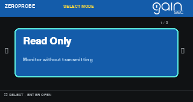
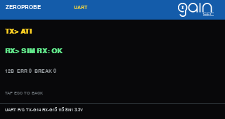
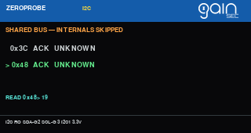
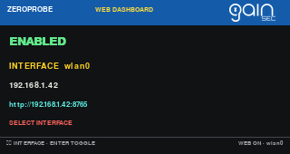

# ZeroProbe

<p align="center">
  
</p>

- **Current version:** 0.5.6
- **Platform:** M5Stack CardputerZero / ARM64 Debian
- **Public repository:** <https://git.gainpalfam.com/cardputorzero/ZeroProbe-Pub>
- **Installable package:** [`dist/zeroprobe_0.5.6-1_arm64.deb`](dist/zeroprobe_0.5.6-1_arm64.deb)

## Description

ZeroProbe is a safety-first GPIO, UART, and I²C interface explorer for the M5Stack CardputerZero. It combines a native 320×170 operator interface, command-line tools, deterministic simulation, persistent logging, VCD export, and an optional responsive web dashboard.

The application defaults to read-only behavior. Operations that can drive a signal or interact with a shared bus require explicit acknowledgement or a two-step arm/confirm action. ZeroProbe also rejects known CardputerZero pin conflicts unless the operator deliberately overrides the relevant safety gate.

ZeroProbe is not an electrically protected logic analyzer or protocol probe. CardputerZero GPIO uses **3.3 V logic**. Use an external translated and protected front end when connecting an unknown target.

## Screenshots









## Prerequisites

For the packaged CardputerZero application:

```bash
sudo apt update
sudo apt install python3 python3-pygame gpiod
```

For desktop development:

```bash
python3 -m venv .venv
.venv/bin/pip install pygame
```

## Out of the box

- Native 320×170 Pygame interface for APPLaunch.
- Direct RGB565 framebuffer mirroring to the CardputerZero LCD.
- Mode-first workflow: **Read Only** or **Read / Send**, followed by UART or I²C.
- One-card navigation designed for the physical display.
- Bare `F`, `X`, `Z`, and `C` navigation aliases, so routine movement does not require repeated `Fn` presses.
- Short Escape tap to go back without triggering APPLaunch's three-second forced-exit gesture.
- Automatic `gpiomon` / `gpioget` backend selection on-device.
- Deterministic simulator for development and regression testing.
- Read-only GPIO edge capture with VCD export.
- UART receive and explicitly armed transmit/receive on Grove GPIO14/GPIO15.
- ASCII, hexadecimal, framing-error, and break reporting.
- Guarded external-address I²C scanning on GPIO2/GPIO3.
- Selectable I²C results with bounded, explicitly confirmed reads.
- Known internal I²C devices skipped by default.
- Optional no-auth web dashboard bound only to the interface selected on-device.
- Responsive browser controls, live canonical framebuffer, and log download.
- Private rotating activity log at `~/zeroprobe/zeroprobe.log`.
- APPLaunch metadata, icon, runtime files, documentation, and compiled target bytecode in one ARM64 Debian package.

## Install on CardputerZero

Copy the included package to the device and install it:

```bash
scp dist/zeroprobe_0.5.6-1_arm64.deb YOUR_USER@CARDPUTER_IP:/tmp/
ssh YOUR_USER@CARDPUTER_IP
sudo dpkg -i /tmp/zeroprobe_0.5.6-1_arm64.deb
systemctl --user restart APPLaunch.service
```

Launch **ZeroProbe** from APPLaunch.

The package installs:

- `/usr/bin/zeroprobe` — general CLI
- `/usr/share/ZeroProbe/` — application runtime and APPLaunch wrapper
- `/usr/share/APPLaunch/applications/zeroprobe.desktop`
- `/usr/share/APPLaunch/share/images/zeroprobe.png`

No sudoers rule or privileged helper is installed.

## GUI controls

- `F` / Up — previous item
- `X` / Down — next item
- `Z` / Left — previous item or baud
- `C` / Right — next item or baud
- `Enter` — open, arm, or confirm
- `Escape` — tap once to go back

Native arrow keycodes remain supported. In UART Read / Send text entry, printable `F`, `X`, `Z`, and `C` remain payload characters instead of navigation aliases.

Do **not** hold physical Escape for three seconds. APPLaunch reserves that gesture to terminate the entire external application process group.

## CLI

```text
zeroprobe gui
zeroprobe capture
zeroprobe uart
zeroprobe i2c
```

### GUI

Start the application or render a deterministic screenshot:

```bash
zeroprobe gui --backend auto
SDL_VIDEODRIVER=dummy zeroprobe gui --backend sim --screenshot frame.png
```

### GPIO capture

GPIO22 is the default unshared first-test input:

```bash
zeroprobe capture \
  --backend gpio \
  --pins 22 \
  --duration-ms 1000 \
  --output capture.vcd
```

Useful arguments:

- `--backend {auto,gpio,sim}` — select hardware, automatic, or simulated capture.
- `--pins PINS` — comma-separated exposed GPIO numbers or aliases.
- `--duration-ms N` — capture duration.
- `--sample-period-us N` — requested sampling interval.
- `--allow-shared` — explicitly override shared-pin rejection.
- `--output FILE` — write VCD output.

Shared pins are rejected unless `--allow-shared` is supplied. Do not use that option until the conflicting board peripheral is isolated.

### UART

Receive-only wiring:

- Target **TX** → CardputerZero **GPIO15 / Grove RX**
- Target **GND** → CardputerZero **GND**
- Leave CardputerZero **GPIO14 / TX disconnected**

```bash
zeroprobe uart \
  --allow-grove-uart \
  --baud 115200 \
  --duration-ms 5000 \
  --output uart.txt
```

Transmit and receive only after confirming both sides use 3.3 V TTL:

```bash
zeroprobe uart \
  --allow-grove-uart \
  --allow-uart-tx \
  --baud 115200 \
  --send-text ATI \
  --append crlf \
  --duration-ms 2000 \
  --output uart.txt
```

Important arguments:

- `--device DEVICE` — UART device; defaults to the configured serial interface.
- `--baud RATE` — 1,200 through 230,400 baud.
- `--send-text TEXT` — transmit UTF-8 text before receiving.
- `--send-hex BYTES` — transmit hexadecimal bytes.
- `--append {none,cr,lf,crlf}` — append a line ending.
- `--allow-grove-uart` — acknowledge Grove GPIO15 receive use.
- `--allow-uart-tx` — separately acknowledge active transmission on GPIO14.
- `--max-bytes N` — bound captured data.
- `--simulate` — use deterministic simulated UART traffic.

The CLI limits one transmitted payload to 4,096 bytes. The GUI limits its printable TX field to 64 characters, appends CRLF, and requires a two-step arm/start action.

## Guarded I²C scan

The top expansion I²C signals are **GPIO2 / SDA** and **GPIO3 / SCL** at 3.3 V. They share `/dev/i2c-1` with internal hardware.

```bash
zeroprobe i2c --allow-shared-i2c --output i2c.txt
```

Important arguments:

- `--device DEVICE` — select the I²C adapter.
- `--allow-shared-i2c` — acknowledge use of the live shared bus.
- `--include-internal --allow-internal-i2c` — separately override internal-address exclusion.
- `--simulate` — report deterministic simulated addresses.
- `--output FILE` — write the scan report.

ZeroProbe skips known internal addresses `0x10`, `0x32`, `0x34`, `0x4f`, `0x55`, and `0x68` by default. Discovery rows report only observed acknowledgements; device identity remains `UNKNOWN` unless independently established. A read probe can still affect device state.

## Web dashboard

The web dashboard is disabled by default and has no authentication. Enable it only on a trusted interface:

1. Open **Web Dashboard** on the device.
2. Select the required interface, such as `wlan0`.
3. Press Enter to enable it.
4. Open the exact URL shown on-device, normally `http://CARDPUTER_IP:8765/`.

The browser provides:

- A large live view of the canonical device framebuffer.
- Responsive desktop and phone layouts.
- Directional, Enter, and Escape controls.
- Keyboard forwarding and UART text entry.
- Live transport status.
- Download of the same persisted activity log used when the web feature is disabled.

Browser input is forwarded into the native controller. It does not bypass UART or I²C arming gates.
Cross-origin key requests and non-JSON control payloads are rejected to prevent browser-based request forgery. The dashboard still has no user authentication; any peer that can directly reach the selected interface can view and operate it.

## Logging

ZeroProbe logs automatically, even when the web dashboard is disabled:

```text
~/zeroprobe/zeroprobe.log
```

- Log directory mode: `0700`
- Log file mode: `0600`
- Rotation threshold: 1 MiB
- Retained backups: three

Events include startup, shutdown, web startup, screen/status transitions, UART TX/RX bytes, and I²C discoveries. Log write failures are nonfatal.

## Build the Debian package

Stage the package tree:

```bash
PYTHONPATH=. python3 tools/build_deb.py --stage-only
```

Build on Debian or in an ARM64 Debian container:

```bash
python3 tools/build_deb.py
```

The supplied smoke image installs the finished package and exercises the installed CLI and GUI paths:

```bash
docker buildx build \
  --platform linux/arm64 \
  -f packaging/Dockerfile.smoke \
  --load \
  -t zeroprobe-smoke:0.5.6 .
```

## Verification

Run the complete regression suite:

```bash
PYGAME_HIDE_SUPPORT_PROMPT=1 \
PYTHONPATH=src:. \
.venv/bin/python -m unittest discover -s tests -v
```

The 0.5.6 release passed:

- 83 unit and integration tests.
- Python source compilation.
- Clean ARM64 Debian package installation.
- Installed-path simulated GPIO, UART RX, UART TX/RX, and I²C checks.
- Installed-path 320×170 GUI rendering.
- 18-state on-device UI acceptance on CardputerZero.
- On-device web frame, input, settings, and log acceptance.

External electrical behavior must still be validated against a known protected 3.3 V source and, where timing matters, an independent analyzer.

## Safety

- **3.3 V logic only.** Do not connect RS-232, 5 V UART/I²C, or an unknown-voltage signal directly.
- Measure target idle voltage before connection.
- Use a common ground.
- Keep UART TX disconnected during the first receive-only test.
- Treat `--allow-shared`, `--allow-shared-i2c`, `--allow-internal-i2c`, and `--allow-uart-tx` as deliberate safety acknowledgements.
- Do not hot-plug a Cap module while ZeroProbe owns a shared interface.
- Do not publish an assumed maximum capture rate without comparing event loss and timestamps against an external analyzer.

## Authors

- **Jon Gaines** — [GainSec](https://gainsec.com)

## Acknowledgments

- [M5Stack](https://m5stack.com) for the CardputerZero platform and APPLaunch ecosystem.
- [libgpiod](https://git.kernel.org/pub/scm/libs/libgpiod/libgpiod.git/) for Linux GPIO tooling.
- [Pygame](https://www.pygame.org/) for the native UI runtime.

## License

Released under the [MIT License](LICENSE).
